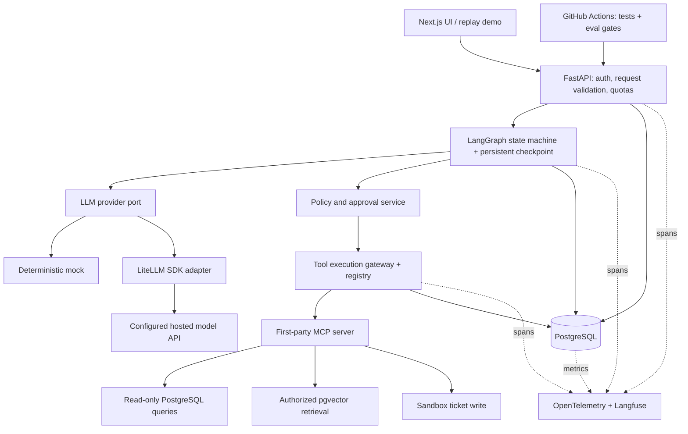

# AgentOps AI — Architecture and Requirements Specification

**Version:** 3.0 (design specification)  
**Date:** 2026-11-19  
**Status:** Proposed; no implementation or benchmark is implied  
**Primary audience:** Engineering, Claude Code, reviewers, and hiring managers  
**Target roles:** Senior Applied AI Engineer / Senior Agentic AI Engineer; secondary AI Platform Engineer

> **Product thesis.** Build a provider-agnostic, security-first agentic platform that can analyze synthetic business information, retrieve attributable evidence, and propose or perform narrowly authorized actions with human approval. Make the system measurable, resumable, affordable to test, and demonstrably safe within a documented threat model.

## 1. Scope and decisions

### 1.1 User story

An authorized business analyst requests: **"Analyze quarterly sales, identify the three largest declines, consult relevant company policies, prepare a cited executive summary, and propose a follow-up ticket."** The platform retrieves only permitted documents, performs constrained read-only analytics, summarizes grounded evidence, pauses before any write, and records execution outcome and trace.

### 1.2 Phase 1 versus Phase 2

| Decision | Phase 1 — required / staged | Phase 2 — only with evidence of need |
|---|---|---|
| Agent design | Start with one end-to-end LangGraph workflow; progressively introduce Research, Data Analyst, and Reporting specialist roles when evaluation warrants | Larger multi-agent networks, agent-to-agent protocol, autonomous delegation |
| Nodes | Approx. 6–8 for first vertical slice; 12–15 *logical* graph nodes once Phase 1 is complete, not a quota | More subgraphs only when recovery boundaries or reuse justify them |
| LLM | Mock provider + one hosted free-quota model, through a provider-independent contract and LiteLLM SDK adapter | Dedicated LiteLLM Gateway, dynamic cost/quality routing, extra paid providers |
| Data and tools | Synthetic PostgreSQL sales dataset, local/seeded documents, first-party MCP server with controlled read tools and a sandbox write | Google Drive, GitHub production OAuth, Jira/Slack/Gmail real writes, web search |
| Retrieval | Permission-filtered pgvector retrieval with exact references and abstention | Hybrid search, reranking, semantic caching, advanced retrieval experiments |
| Runtime | Postgres checkpointing, approve/resume, finite limits, idempotent side-effects, controlled retries | Dedicated durable queue, autoscaling, distributed executor orchestration |
| Security | Authenticated or tightly restricted demo; deterministic tool authorization; PII handling; injection tests; audit trail | Enterprise SSO, complex multi-tenancy, extended compliance certification |
| Observability | Correlated OpenTelemetry spans + Langfuse traces, redacted structured events, user feedback | Advanced anomaly detection, SLO alerting, online experiments at scale |
| Deployment | Local Docker Compose; replay-only public demo; optionally free-tier frontend/API/database | AWS ECS + RDS + SQS + Terraform, Kubernetes, HA/DR |
| ML/inference | No local GPU and no fine-tuning required | Separate PEFT/LoRA/vLLM performance project |

**Non-goals in Phase 1:** unrestricted web browsing, arbitrary SQL generation/execution, shell/code execution by agents, autonomous messaging, production customer data, unbounded delegation, full OAuth ecosystem, Kubernetes, fine-tuning, and claims of enterprise-grade uptime.

### 1.3 Five portfolio concepts evaluated

1. **AI Operations Agent** (chosen flagship): cross-system work with secure tools, evaluation, and recovery.
2. **Enterprise RAG Platform**: permission-aware ingestion and grounded knowledge retrieval.
3. **LLM Evaluation & Observability Platform**: datasets, tracing, judges, cost and regression gates.
4. **AI Code Review Agent**: GitHub PR analysis with suggestions and static checks.
5. **LLM Serving & Optimization Lab**: open model hosting, quantization, throughput, latency.

## 2. Logical architecture



**Trust boundaries:** user request; application authentication; content returned from external data/tools; model output; operation requiring authorization; outbound telemetry. Data and tools may be accessed only through independently enforced server-side policies. An LLM response is never an authorization decision.

### 2.1 Agent responsibilities

- **Research Agent:** permission-aware retrieval, provenance, conflicting source detection, unsupported-query abstention. Its output is structured evidence with source IDs, not unsupported claims.
- **Data Analyst Agent:** calls constrained, predeclared analytics tools against synthetic sales data; produces validated metrics and assumptions. It never receives arbitrary SQL-write capabilities.
- **Reporting & Action Agent:** synthesizes the two outputs, prepares a report and a proposed ticket. It cannot directly execute the ticket write; only the independent tool gateway can execute an approved action.
- **Orchestrator:** deterministic LangGraph routing, concurrency limits and state management. The planner may consult an LLM but the orchestration layer itself is not counted as a fourth independent agent.

### 2.2 Proposed graph units (not a mandated count)

1. `validate_request` — authenticated principal, schemas, task constraints.
2. `input_policy` — request risk controls, PII treatment, quotas.
3. `plan_and_route` — create bounded task plan and choose specialist(s).
4. `research` — permission-filtered RAG and optional reference tool.
5. `analyze_data` — typed analytics calls to read-only SQL.
6. `synthesize_report` — structured grounded answer and ticket proposal.
7. `authorize_tool` — mandatory policy check for proposed external action.
8. `approval_interrupt` — pause/resume with explicit human consent.
9. `execute_tool` — idempotent execution through MCP gateway.
10. `reconcile_tool` — confirm ambiguous or previously committed outcome.
11. `aggregate_evidence` — combine provenance and data results.
12. `output_policy` — schema, claims, citations, secrets/PII checks.
13. `assemble_response` — serialize safe result and run details.
14. `persist_final_state` — terminal status and final audit record.

Nodes 4–6 are specialist roles; some are conditional/parallel and some belong inside subgraphs. Tool checks must happen **before every privileged tool execution**, not only after report generation. If a node needs multiple side effects, isolate them into tasks with explicit recovery semantics. Observation is cross-cutting, not a final node.

### 2.3 Typed graph state — proposed contract

```python
class AgentRunState(TypedDict, total=False):
    run_id: str
    thread_id: str
    tenant_id: str
    user_id: str
    request_id: str
    task_text: str
    task_plan: list[dict]
    retrieved_evidence: list[dict]
    analytics: dict
    draft_report: dict
    proposed_action: dict | None
    approval_id: str | None
    policy_decisions: list[dict]
    tool_execution_ids: list[str]
    llm_provider: str
    llm_model: str
    cumulative_llm_calls: int
    cumulative_token_count: int
    status: str
    errors: list[dict]
```

**State rules:** JSON-compatible values only; avoid storing credentials and large document payloads in checkpoints; store references and source hashes instead. `run_id` is distinct from `thread_id`; all retained records are access scoped.

## 3. Functional requirements

Requirements use `MUST` for Phase 1 release obligations, `SHOULD` for non-blocking Phase 1 improvements, and `MAY` for Phase 2.

| ID | Requirement | Acceptance evidence |
|---|---|---|
| FR-001 | The API MUST accept authenticated or scope-limited demo tasks with validated schemas. | Valid requests succeed; malformed requests return documented 4xx errors. |
| FR-002 | The orchestrator MUST execute a bounded plan and produce a terminal or waiting state. | Graph test asserts deterministic transitions, step/time budgets, and termination. |
| FR-003 | Retrieval MUST filter by the request principal's allowed document scope before exposing results. | Two-tenant synthetic fixture; zero cross-scope documents returned. |
| FR-004 | Data tools MUST be typed and read-only with a DB account that lacks write rights. | Attempts to mutate tables are rejected by application and DB privileges. |
| FR-005 | The system MUST include a first-party MCP server exposing at least two read tools and one sandbox write. | Tool listing, schema validation, authorization, integration tests. |
| FR-006 | External writes MUST require an approval bound to principal, action payload hash, policy version, expiration and run. | Modified/expired/denied approval fails closed; no write committed. |
| FR-007 | External write execution MUST use an idempotency registry and reconciliation path. | Duplicate request/concurrent retries produce at most one committed sandbox ticket. |
| FR-008 | A paused or failed run MUST recover from persistent checkpoints using the same thread identity. | Process restart test restores state, avoids replaying completed side effects. |
| FR-009 | LLM provider selection MUST be independent of agent business logic. | Mock and one hosted adapter pass a shared contract suite. |
| FR-010 | The LLM gateway MUST check capabilities before binding tools / structured output. | Unsupported model fails with typed `MODEL_CAPABILITY_UNSUPPORTED`. |
| FR-011 | The backend MUST enforce max steps, calls, time, concurrency and approximate token budget. | Exhaustion emits explicit terminal status and stops further LLM calls. |
| FR-012 | The app MUST produce evidence-linked reports and abstain when evidence is missing. | Golden dataset checks citations and unsupported-answer behavior. |
| FR-013 | Run detail MUST expose sanitized state, approvals, policy decisions and trace IDs. | UI integration test; telemetry canary values absent. |
| FR-014 | The app MUST accept explicit thumbs-up/down feedback per run. | Feedback persists with run/eval case reference and can be exported for review. |
| FR-015 | A public demo MUST have fully functional replay mode without any model call. | Offline/replay demo loads pre-recorded synthetic runs with network disabled. |
| FR-016 | The system SHOULD compare a simple single-agent baseline with specialists on identical cases. | Measured table of quality, latency, cost and model settings. |

## 4. Non-functional requirements and quality attributes

| ID | Attribute | Phase 1 target / evidence |
|---|---|---|
| NFR-001 | Least privilege | No unauthorized tool action in the versioned security fixture suite. |
| NFR-002 | Auditability | 100% of evaluated workflows have run ID, trace ID and policy decision record. |
| NFR-003 | Recoverability | All defined crash/retry test scenarios resume or enter explicit reconciliable state. |
| NFR-004 | Privacy | No unredacted API key, canary secret or raw sensitive fixture in outbound traces. |
| NFR-005 | Report validity | Proposed initial target >=99% schema-valid outputs on measured set. |
| NFR-006 | Task quality | Proposed target >=85% task success on a clearly defined, versioned evaluation set; report CI and sample size. |
| NFR-007 | Evidence quality | Proposed target >=90% correct support for evaluated cited claims; abstention when unsupported. |
| NFR-008 | Performance | Report p50/p95 and token/cost per successful task; set latency SLO only after baseline. |
| NFR-009 | Cost control | Mock-first, explicit live opt-in, persistent budgets and provider limits; no spend promise. |
| NFR-010 | Reproducibility | Locked dependencies, seeded synthetic data, documented env and CLI smoke test. |

Targets are design goals, **not actual benchmark results**. Report failed cases, measurement dates, model versions, confidence intervals when meaningful, and costs under the tested workload. Do not use small samples to claim universal safety.

## 5. Provider-agnostic LLM gateway

### 5.1 Contract

```python
class ModelRequest(BaseModel):
    run_id: str
    messages: list[dict]
    response_schema_name: str | None = None
    required_capabilities: set[str] = set()
    max_output_tokens: int = 500
    timeout_seconds: int = 30

class ModelResponse(BaseModel):
    text: str | None
    structured: dict | None
    tool_calls: list[dict] = []
    provider: str
    model: str
    prompt_tokens: int | None = None
    completion_tokens: int | None = None
    elapsed_ms: int
    estimated_cost_usd: float | None = None
```

Implement an `LLMProvider` protocol with `generate(request)` and `capabilities(model)`. `MockLLMProvider` returns deterministic responses keyed by fixture/test case. `LiteLLMProvider` adapts actual LiteLLM responses, including tool-call normalization, structured-output validation, errors, and usage fields. Avoid claiming universal capability: validate model+provider combinations (tool calling, JSON schema, streaming, maximum context, token usage reporting). Phase 1 should use at most one real API provider in continuous development; provider contract tests must be isolated from paid usage.

### 5.2 API key handling

Credentials live in environment/server secrets, never in UI or Git. The demo must never ask arbitrary visitors to paste an API key into an untrusted public form. If bring-your-own-key becomes a feature later, it requires a full scoped secret storage / revocation and threat-model design. Independent provider adapter errors are typed: `RATE_LIMITED`, `AUTH_FAILED`, `TIMEOUT`, `CAPABILITY_UNSUPPORTED`, `PROVIDER_UNAVAILABLE`, `BUDGET_EXCEEDED`.

### 5.3 Test modes

- `mock`: no network LLM calls; mandatory for PR CI and all acceptance logic tests.
- `hosted_free`: opt-in hosted model in a documented free allowance, with strict caps. Verify provider-specific quota, availability, and data terms at setup.
- `live_paid`: manual opt-in only, guarded by persistent call/token budget and operator approval.
- `replay`: view previously saved synthetic runs; zero calls, valid even if providers are unavailable.

A **single end-to-end workflow can invoke an LLM multiple times**. A budget limits calls/tokens across the entire run; it cannot guarantee a specific dollar amount unless pricing and usage are checked, including ancillary services.

## 6. External tools and MCP contract

### 6.1 Phase 1 tool catalog

| Tool name | Backing implementation | Permissions | Side effects |
|---|---|---|---|
| `get_sales_summary` | Parameterized read-only PostgreSQL query | `sales:read` | None |
| `search_approved_documents` | pgvector retriever with ACL filter | `docs:read` | None |
| `get_issue_details` | Seeded GitHub issue fixture or optional GitHub read-only API | `issues:read` | None |
| `create_followup_ticket` | Sandbox ticket repository with unique external reference | `tickets:write` + HITL | Creates one test ticket |

The **first-party MCP server** exposes tools through typed JSON Schema contracts, but business authorization is enforced in a **server-side Tool Gateway**, not by trusting tool descriptions. HTTP-exposed MCP servers need transport-appropriate identity and authorization; the easiest Phase 1 deployment can use local stdio MCP behind a trusted backend process. The tool gateway must never forward raw bearer tokens or expose untrusted MCP servers automatically.

### 6.2 Tool request/response envelopes

```json
{
  "run_id": "uuid",
  "tenant_id": "demo-a",
  "principal_id": "user-1",
  "tool_name": "create_followup_ticket",
  "schema_version": "1.0",
  "args": {"product_id": 101, "summary": "Investigate sales decline"},
  "approval_id": "approval-uuid",
  "idempotency_key": "generated-server-side-key",
  "trace_id": "otel-trace-id"
}
```

The gateway must independently verify identity, tool allowlist, arguments, data scope, action hash, approval, limits and status of prior execution before performing a write. The model must not be able to assign its own authorization scope or modify the idempotency key.

### 6.3 Future connectors (Phase 2)

Google Drive OAuth and retrieval; GitHub repository/PR integration; Jira tickets; Slack notifications; Gmail draft creation; licensed web-search API. For every connector define scopes, read/write boundaries, approval policy, retry semantics, rate limits, secret rotation and a sandbox test account. No blanket write scopes.

## 7. Reliability: durable execution, concurrency and idempotency

### 7.1 Persistence

Use PostgreSQL `AsyncPostgresSaver` or current supported LangGraph Postgres checkpointer; initialize schemas explicitly. Every run uses a persistent `thread_id` and must be resumable after application process restart. A checkpointer protects graph progress **but does not create exactly-once semantics for external services**. On graph replay, a node can run from its start; put nonrepeatable operations in isolated tasks and use application-level idempotency/reconciliation.

### 7.2 Execution registry — proposed schema

```sql
CREATE TABLE tool_executions (
  id UUID PRIMARY KEY,
  tenant_id TEXT NOT NULL,
  run_id UUID NOT NULL,
  tool_name TEXT NOT NULL,
  idempotency_key TEXT NOT NULL,
  action_hash TEXT NOT NULL,
  approval_id UUID,
  status TEXT NOT NULL CHECK (status IN
    ('reserved', 'executing', 'succeeded', 'failed', 'uncertain')),
  attempt_count INTEGER NOT NULL DEFAULT 0,
  external_reference TEXT,
  result_json JSONB,
  error_code TEXT,
  trace_id TEXT,
  created_at TIMESTAMPTZ NOT NULL DEFAULT NOW(),
  updated_at TIMESTAMPTZ NOT NULL DEFAULT NOW(),
  UNIQUE (tenant_id, tool_name, idempotency_key)
);
```

A transaction reserves one row with `INSERT ... ON CONFLICT`, a worker claims it atomically, and no second caller may execute while ownership is active. If the upstream API supports idempotency keys, pass a stable key. If a response is lost after an external write, mark `uncertain`, query upstream by external reference, then reconcile before retrying. Avoid claiming the local registry guarantees universal exactly-once execution. The sandbox tool must support deterministic uniqueness for a meaningful end-to-end test.

### 7.3 Failure matrix

| Failure | Required behavior |
|---|---|
| 429 model rate limit | Bounded backoff; respect retry headers; stop at per-run limit. |
| Invalid tool args | Reject before invocation; log a sanitized policy result. |
| Timeout before write | Retry only if known safe and budget available. |
| Timeout after external commit | Set `uncertain`; reconcile using external reference. |
| Duplicate concurrent request | Return prior execution status/result or wait; no duplicate write. |
| API restart during HITL | Approval survives; only original principal/action may resume. |
| DB temporarily unavailable | Fail closed for writes and approvals; no in-memory fallback to unsafe execution. |
| Untrusted retrieval instruction | Treat as data; tool and policy scopes unchanged. |

## 8. Retrieval and context engineering

- Ingest **synthetic documents** with stable `document_id`, `source_uri`, `tenant_id`, access labels, hash, version, timestamps and chunk metadata.
- Enforce ACL filtering **before** returning candidates to the model, not only with a post-answer filter.
- Retrieval returns top-k chunks, citation metadata, scores, and source hashes; do not expose inaccessible chunk IDs.
- Context assembly uses configurable token budget, selective history, prioritization of verified evidence, bounded chunk count, and truncation logging.
- Treat retrieved documents and tool outputs as untrusted **data**, not new system instructions.
- If evidence does not support a claim, abstain or explain uncertainty; reject invented citations.
- Benchmark baseline vector retrieval first; defer hybrid search and reranking until retrieval metrics show an issue.

## 9. Safety, security, threat model

**Deterministic boundaries are mandatory.** The model may propose a tool, not authorize it. Defense layers:

1. **Input:** Pydantic schema, length/token quota, request policy, classifier signals for injection/PII; heuristics can be wrong.
2. **Retrieval:** tenant/user ACL, source provenance, source type allowlist, data classification, context separation.
3. **Tools:** typed args, server-owned identity/scope, least privilege, DB read-only role, URL allowlists, outbound restrictions, action digest, HITL for write.
4. **Runtime:** max steps, timeouts, budget limit, concurrency limit, kill switch, no arbitrary shell or browser access.
5. **Output:** structured result validation, citations, sensitive-data scan, safe failure and abstention.
6. **Telemetry:** redact secrets/PII before export, restrict access and retention, never log raw API keys.

**Threat tests (versioned and reproducible):** injected instructions in a source PDF; malicious tool result; attempted `DROP TABLE`; cross-tenant retrieval; forged approval; changed approved payload; replayed approval; duplicated ticket request; trace secret canary; infinite tool loop; unexpected external domain. Track attack success, blocked unsafe actions, false positives, and remaining limitations.

**Authentication:** Phase 1 may use a clearly scoped, nonproduction single-user demo identity for replay. Any live execution or write must be authenticated and explicitly authorized. If multi-tenant isolation is claimed, tests must use two distinct synthetic tenants and enforced backend policies.

## 10. Observability, feedback and evaluation

### 10.1 Telemetry plan

Use OpenTelemetry for correlation across FastAPI, LangGraph, LLM calls, retrieval and tools; export sanitized observations to Langfuse. Span taxonomy: `http.request`, `agent.run`, `agent.node`, `llm.generate`, `rag.retrieve`, `tool.authorize`, `approval.wait`, `tool.execute`, `tool.reconcile`, `policy.evaluate`, `eval.case`. Each observation includes `trace_id`, `run_id`, time, sanitized outcome, model/provider where relevant, policy version and cost/usage if available.

Metrics: end-to-end task success, groundedness, citation correctness, tool-choice correctness, permission violations, action duplication, latency p50/p95, retry rate, 429s, token volume, estimated cost and **cost per successful task**. Review and document telemetry fields that are intentionally *not* captured.

### 10.2 Evaluation suite

Start with **50 curated synthetic cases**, growing toward 80–120 when useful. Version cases, baselines and scoring rules. Suggested slices:

| Category | Cases (initial suggestion) | Evaluation |
|---|---:|---|
| Straightforward business requests | 10 | Expected metrics, correct tool path |
| Multi-source evidence | 8 | Citation support, provenance |
| Missing/contradictory evidence | 6 | Abstain or qualify |
| Tool selection and schema issues | 6 | Correct tool + arguments |
| Prompt injection | 8 | Permission boundary held |
| Access control and malicious output | 4 | No unauthorized disclosure/write |
| HITL, retry, crash, duplicate writes | 6 | Recovery and at-most-once observed write |
| Budget/timeout/provider failure | 2 | Safe, explicit termination |

Primary task success and safety cases are human-labeled/deterministic where practical. LLM-as-judge is optional and must be calibrated on a labeled subset before scores become release gates. Use separate development and held-out cases, and keep test fixture leakage in mind.

### 10.3 CI and releases

- **Every PR without paid LLM calls:** format, lint, typing, unit, integration, contract, security policy, deterministic graph trajectory, provider mock and idempotency tests.
- **Release candidate:** full offline held-out suite, fault injection, screenshot/UI smoke tests, sanitized trace check, runnable Docker Compose demo.
- **Manual opt-in live smoke:** small capped cases with one compatible hosted model; never run by default in untrusted PR contexts.
- **Artifacts:** run ID, git SHA, dataset version, prompt version, policy version, provider/model version, samples, raw scores, report and known limitations.
- **Non-negotiable gates:** zero unauthorized writes in the tested cases, zero duplicate sandbox side effects in the retry matrix, required tests passing. Other numeric thresholds are provisional and must be adjusted with baseline evidence.

## 11. API, data contracts, and repo layout

### 11.1 Minimum API surface

| Method | Route | Purpose |
|---|---|---|
| POST | `/v1/runs` | Submit a task with request idempotency key. |
| GET | `/v1/runs/{run_id}` | Sanitized run detail and trace link. |
| GET | `/v1/runs/{run_id}/events` | Bounded SSE/event polling, if supported. |
| POST | `/v1/runs/{run_id}/approvals/{approval_id}` | Approve/reject a specific action with binding checks. |
| POST | `/v1/runs/{run_id}/feedback` | Submit human feedback. |
| GET | `/v1/tools` | Authorized tool listing and metadata. |
| GET | `/health/live` | Process liveness. |
| GET | `/health/ready` | Dependencies and ready status. |
| GET | `/v1/demo/replays` | Synthetic replay catalog. |

Use stable problem details for errors (`code`, `message`, `request_id`) without leaking stack traces or secrets. Mutations require authentication, authorization and CSRF/appropriate session handling as applicable.

### 11.2 Suggested database entities

`users`, `tenants`, `roles`, `documents`, `document_chunks`, `business_sales`, `agent_runs`, `approvals`, `tool_executions`, `policy_events`, `run_feedback`, `eval_cases`, `eval_results`. The LangGraph checkpointing library may maintain its own tables. All per-tenant tables have scope metadata and indexes. Separate app migrations from checkpointer setup.

### 11.3 Repository

```text
agentops-ai/
  apps/api/                 # FastAPI endpoints and dependency wiring
  apps/web/                 # Next.js UI and replay views
  packages/core/            # typed domain contracts, policies, state
  packages/agents/          # LangGraph state machine and roles
  packages/llm/             # mock and LiteLLM adapters, registry
  packages/retrieval/       # document processing, ACL, context
  packages/tools/           # execution gateway, MCP server, connectors
  packages/telemetry/       # OpenTelemetry + Langfuse adapters
  packages/evals/           # scoring and reproducible datasets
  testsuite/{acceptance,unit,integration,security,reliability,contracts,evals,live}/  # product tests; tests/ is the harness's (D-002)
  datasets/synthetic/
  fixtures/{llm,replays,tool_results}/
  docs/{architecture,threat-model,runbooks,decisions}/
  infra/terraform/aws/      # phase 2 only
  .github/workflows/
  .github/copilot-instructions.md
  CLAUDE.md
  docker-compose.yml
  .env.example
  pyproject.toml
  README.md
```

## 12. Deployment and cost policy

**Local:** Docker Compose for API, Postgres/pgvector, and optional web. No local LLM required. Mock mode default. **Public demo:** static/replay frontend plus optional free-tier FastAPI and managed Postgres; prior candidates are Vercel, Render, Supabase and Langfuse Cloud. **Live tests:** hosted quota-eligible model only after current terms and availability are verified. Free-tier services can sleep, suspend, impose noncommercial terms, or change quotas; never guarantee $0 across all usage. A paid Railway or cloud configuration is an optional upgrade, not a Phase 1 requirement.

For long-lived background jobs, do not assume an HTTP request or an ephemeral in-process task will survive; Phase 1 may constrain runtime and execute short tasks with checkpoints. If long-running throughput becomes a requirement, introduce a durable worker/queue in Phase 2. Explicitly document the present durability boundary.

## 13. Delivery plan and definition of done

| Milestone | Work | Required artifact |
|---|---|---|
| M0 — Foundation | Setup, mock adapter, health endpoint, synthetic dataset, typed state | FastAPI responds; `pytest` passes without any keys |
| M1 — Vertical slice | Single graph: SQL + RAG + grounded report + trace ID | Deterministic E2E run and replay fixture |
| M2 — Secure tool platform | MCP tools, policy gateway, approval, registry | Authorization, approval binding and duplicate-write tests |
| M3 — Durable/evaluable | Postgres checkpoints, fault matrix, context limits, eval harness, redaction | Crash/replay proof and versioned evaluation output |
| M4 — Specialist experiment | Research, Analyst, Reporting roles; compare against single-agent baseline | Actual results; retain simpler design if better |
| M5 — Public portfolio | Replay-first UI, optional hosted model, CI, docs, demo video | Recruiter demo; reproducible test and measured scorecard |

**Exit criterion for Phase 1:** a reviewer can run `docker compose up`, load synthetic data, execute/replay a scenario, show an unauthorized action blocked, observe a trace, intentionally retry an approved sandbox action without duplication, and reproduce the published tests. Use a single success criterion per milestone and avoid building new connectors before these pass.

## 14. Phase 2 option catalog

Prioritize extensions by interview target and measured need, not novelty:

- **Enterprise retrieval:** hybrid lexical + dense, reranking, ACL-aware Google Drive ingestion, citation graph.
- **Model platform:** LiteLLM Proxy, multi-provider routing, semantic cache, production budget dashboards.
- **Production architecture:** AWS ECS/RDS/SQS/Secrets Manager, Terraform, deployment rollback, load tests and runbooks.
- **Security/governance:** production OAuth, signed tool manifests, scoped token delegation, richer identity/tenant boundaries.
- **Agent collaboration:** A2A when independently deployed agents genuinely need it; multi-agent ablation study first.
- **Long-term memory:** isolated per-principal store, consent/retention/deletion controls and poisoning evaluations.
- **Additional connectors:** Jira, Slack, Gmail and GitHub PR tools with least-privilege scopes and HITL.
- **Inference specialization:** distinct LoRA/PEFT/vLLM lab if pursuing ML-focused roles.

### Future specialized agent and adjacent product backlog

1. Business Operations Analyst — default flagship.
2. Enterprise Knowledge Agent — RAG and source permissions.
3. Research and Report Agent — multi-source synthesis.
4. AI Code Review Agent — GitHub diffs and test suggestions.
5. Data Quality Agent — drift checks and gated remediation.
6. Incident Triage Agent — incident summaries and runbook citations.
7. Customer Support Agent — policy-based answers and escalation.
8. Workflow Automation Agent — approved cross-app actions.
9. Evaluation Agent — generates candidate evaluation cases for human review.
10. Cost and Reliability Agent — monitors usage and proposes optimizations.
11. LLM Inference Lab — separate benchmarking project, not necessarily an agent.

## 15. Interview evidence and honest claims

Show a 2-minute demo, an architecture diagram, 4–6 ADRs, threat model with blocked attack, Langfuse trace, idempotency/fault-injection test, reproducible evaluation report, CI screenshot and deployment notes. Do not assert that the system is production certified, highly available, secure against all injections, or used by customers. A portfolio demonstrates design and test discipline; it does not substitute for operating enterprise software with a team.

## 16. Source notes (reviewed 2026-11-19)

The following public sources motivate the design; this document's numerical targets and scope decisions are **proposals**, not attributed findings.

- LangChain, *State of Agent Engineering* (2026): https://www.langchain.com/state-of-agent-engineering
- AWS, *Well-Architected Agentic AI Lens* (2026): https://docs.aws.amazon.com/wellarchitected/latest/agentic-ai-lens/agentic-ai-lens.html
- LangGraph, *Graph API / replay and idempotency*: https://docs.langchain.com/oss/python/langgraph/graph-api
- LangGraph, *Interrupts*: https://docs.langchain.com/oss/python/langgraph/interrupts
- LangGraph, *Persistence*: https://docs.langchain.com/oss/python/langgraph/persistence
- MCP specification (2026-07-28): https://modelcontextprotocol.io/specification/2026-07-28
- OWASP GenAI Security Project: https://genai.owasp.org/
- Langfuse, LangChain/LangGraph integration: https://langfuse.com/integrations/frameworks/langchain
- LiteLLM documentation: https://docs.litellm.ai/
- 6sense Sr. AI Engineer role snapshot: https://job-boards.greenhouse.io/6sense/jobs/8257108

**Document authority:** This specification is the source of truth for requirements. `CLAUDE_CODE_HANDOFF.md` is its execution guide. The PDF is the executive and portfolio blueprint. If they diverge, update this file first, then refresh the others.
